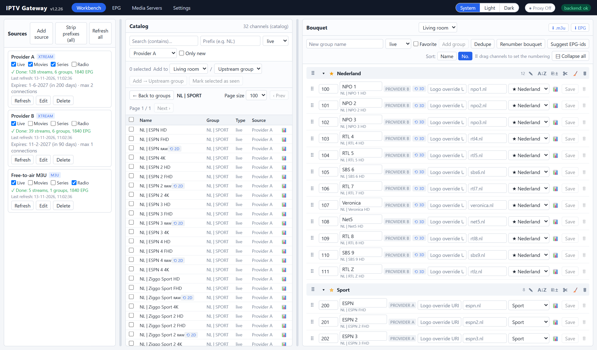
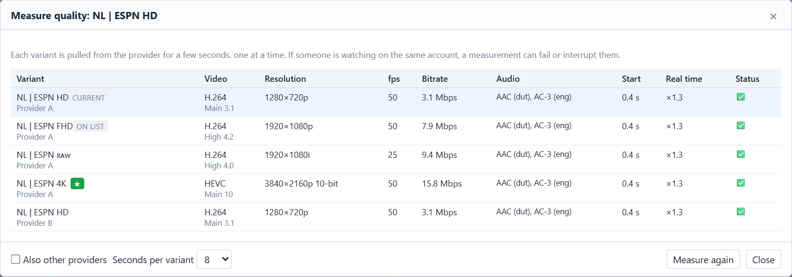
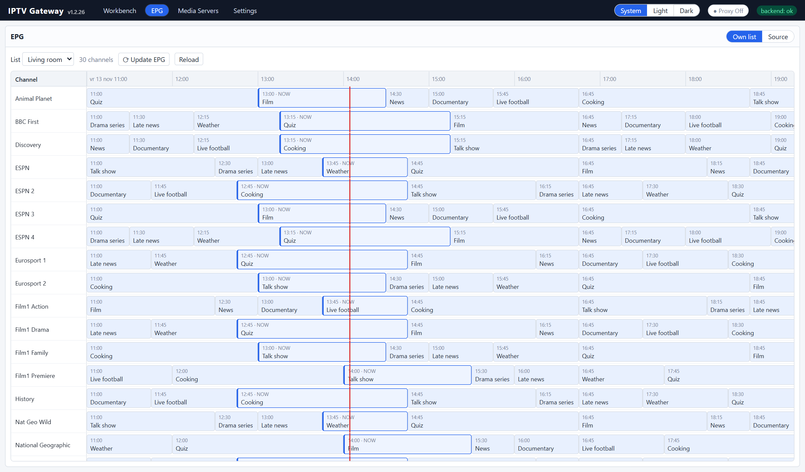
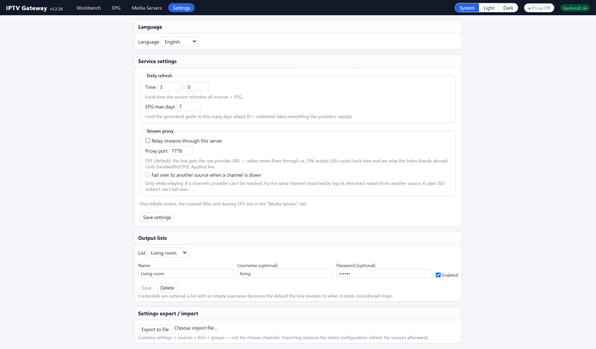

# IPTV Gateway

[](https://github.com/IPTVGateway/iptv-gateway/actions/workflows/frontend.yml)
[](LICENSE)

**Merge the IPTV subscriptions you already have into one clean, curated line-up,
and serve it as your own Xtream Codes portal, M3U playlist, XMLTV guide and
HDHomeRun tuner.**

Point any IPTV box (TiviMate, IPTV Smarters, OTT Navigator, MAG/Formuler apps…) or
Plex at the gateway and it sees *your* bouquet: merged across providers, renamed,
regrouped, numbered and sorted, with only the guide data for the channels you
actually chose.

> **Video does not flow through the gateway by default.** Boxes get the
> provider's own URL (M3U) or a `302` redirect to it (Xtream). Only the optional
> stream proxy relays video. It is meant for use abroad, or for boxes that can
> only reach your home server.



<sub>Screenshots use fictional demo data. No real provider is shown.</sub>

---

## Features

**Sources**
- Xtream Codes portals and M3U / M3U_plus playlists, merged into one catalog.
- Live / Movies / Series / Radio can be switched on or off per source.
- Per-provider User-Agent and Referer, and an "always HLS" option.
- Account status, expiry date and connection limit shown per provider.
- A daily automatic refresh of channels and EPG.

**Curating**
- Include and exclude name filters (prefix/suffix) that never delete anything.
- Prefix/suffix stripping, including decorative letters such as `ʀᴀᴡ` and `ʳᵉᶜ`.
- Change tracking: new channels and groups are flagged until you mark them seen.
- Your own groups (★ favourites on top), drag-and-drop ordering and A→Z sorting.
- Per channel you can set its name, logo, number, group and tvg-id (EPG).
- **Bouquet renumbering**: every group starts on its own hundred (100, 200…).
- **Quality variants**: swap a whole group to another quality or provider
  (RAW / HD / UHD / 4K+…) and keep the numbers and overrides.
- **📊 Quality probe**: measures every variant of a channel (codec, resolution,
  fps, bitrate, real-time ratio) with a built-in MPEG-TS/HLS analyser. No ffmpeg
  needed.

**Output**
- Xtream emulation: `player_api.php`, `get.php`, `xmltv.php`, live/movie/series redirects.
- **Catch-up / timeshift**: the provider's archive is passed through with
  `tv_archive`, `has_archive`, `/timeshift/` and M3U `catchup="xc"`.
- An XMLTV guide restricted to your chosen channels, with optional dummy EPG for
  channels that have no guide.
- **Plex Live TV & DVR**: an HDHomeRun emulation with SSDP discovery, or an M3U
  tuner with XMLTV.
- An optional stream proxy and cross-provider failover.
- Optional HTTPS and an admin password.

## Screenshots

| Quality probe | Guide (EPG) |
|---|---|
|  |  |
| Measure every quality variant of a channel and swap to the best one in one click. | The guide for exactly the channels in your bouquet. |



## Architecture

```
Providers ──read──▶ catalog (SQLite, change-tracked) ──curate──▶ lists / groups / items
                                                                    │
            player_api.php · get.php · xmltv.php · HDHomeRun · 302 redirect / relay
                                                                    ▼
                                                           IPTV box / Plex
```

| Part | Technology |
|---|---|
| Backend (`backend/`) | Delphi (RAD Studio 13), [MARS-Curiosity](https://github.com/andrea-magni/MARS) REST, Indy, FireDAC + SQLite |
| Admin UI (`frontend/`) | React 18 + TypeScript + Vite |
| Hosts | Linux64 console daemon (Docker / systemd), native Windows Service, VCL dev host |

All behaviour lives in `backend/src/core`, and the hosts are thin shells around one
worker thread. [CLAUDE.md](CLAUDE.md) has the architecture, the domain rules and
the implementation notes.

```
backend/
  src/core/          model · sources · ingest · storage · api · scheduler · app
  src/host_service/  cross-platform daemon (Win32 + Linux64), used by the Docker image
  src/host_winsvc/   native Windows Service
  src/host_vcl/      development host (VCL form)
  tests/             DUnitX test suite
  3thParty/          vendored MARS-Curiosity (MPL 2.0)
frontend/            admin web app
deploy/              Dockerfile + Unraid template, systemd unit, Linux64 sysroot
docs/                user guide
```

## Getting started

### Run with Docker (Unraid / any Linux host)

The image packages the prebuilt Linux64 daemon and the admin UI on Debian slim.
See [deploy/docker/README.md](deploy/docker/README.md) and
[deploy/docker/PUBLISH-UNRAID.md](deploy/docker/PUBLISH-UNRAID.md).

```bash
docker load -i iptvplay.tar.gz
docker compose -f deploy/docker/docker-compose.yml up -d
# admin UI: http://<host>:7777/
```

Use host networking if you want Plex to discover the HDHomeRun tuner over SSDP.

### Build from source

Requirements: **RAD Studio 13** (Delphi 13.1) and **Node.js 20+**.

```powershell
# backend: open backend/src/IPTVGateway_Group.groupproj in RAD Studio, or:
msbuild backend\src\host_service\IPTVPlayService.dproj /p:Config=Release /p:Platform=Win32 /p:ProductVersion=37.0

# frontend
cd frontend
npm install
npm run dev          # http://localhost:5173, proxies /api to :7777
```

Copy `backend/config.sample.json` to `config.json` next to the executable and
edit it. `deploy/docker/build.ps1` builds the Linux64 binary and the Docker image.

### Tests

```powershell
cd frontend; npx vitest run          # frontend (Vitest + Testing Library)
# backend: build and run backend/tests/IPTVPlayTests.dpr (DUnitX); see CLAUDE.md
```

## Documentation

- [User guide](docs/USER-GUIDE.md): every screen, connecting a box, Plex, ports.
- [CLAUDE.md](CLAUDE.md): architecture, domain rules and developer notes.

## Disclaimer

**IPTV Gateway is a playlist and EPG management tool. It contains no content,
channels, streams, playlists, provider addresses or credentials, and it never
will.**

- The project does not provide, sell, host, index or link to any TV channels,
  films, series or other media. It does not endorse or recommend any IPTV
  service, and no provider is affiliated with this project.
- It only reorganises sources that **you** configure yourself: playlists and
  portals you are entitled to use, such as your own subscriptions, free-to-air
  or public M3U lists, your own recordings, or a licensed IPTV service.
- Many "IPTV subscriptions" sold online redistribute copyrighted broadcasts
  without permission from the rights holders. In many countries, including the
  EU (CJEU C‑527/15 *Filmspeler*), using such services can itself be unlawful.
  **Make sure you have the right to access every stream you add.** Respect the
  terms of service of your providers and the copyright and broadcasting laws of
  your country.
- Do not use this software to infringe copyright, circumvent geo-restrictions
  or access controls where that is not allowed, or to redistribute streams to
  third parties.
- The software is provided "as is", without warranty of any kind (see
  [LICENSE](LICENSE)). The authors and contributors accept no liability for how
  it is used, or for the legality of any source a user connects to it.
- Channel, broadcaster and product names that may appear in the code, the tests
  or the documentation are used only as illustrative examples. All trademarks
  belong to their respective owners.

Rights holders with a concern can open an issue and it will be looked into
promptly.

## License

[MIT](LICENSE) © IPTV Gateway contributors. Third-party components keep their
own licences, see [THIRD-PARTY-NOTICES.md](THIRD-PARTY-NOTICES.md).

Built largely with [Claude Code](https://claude.com/claude-code), with a human in
the loop steering the design and the testing.
