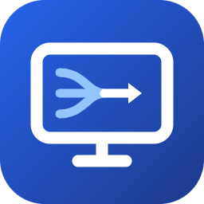

<p align="center"></p>

# IPTV Gateway

[](https://github.com/IPTVGateway/IPTVGateway/actions/workflows/frontend.yml)
[](LICENSE)

**Merge the IPTV subscriptions you already have into one clean, curated line-up,
and serve it as your own Xtream Codes portal, M3U playlist, XMLTV guide and
HDHomeRun tuner.**

Point any IPTV box (TiviMate, IPTV Smarters, OTT Navigator, MAG/Formuler apps…) or
Plex at the gateway and it sees *your* bouquet: merged across providers, renamed,
regrouped, numbered and sorted, with only the guide data for the channels you
actually chose.

> **Video does not flow through the gateway by default.** Boxes get the
> provider's own URL (M3U) or a `302` redirect to it (Xtream). Only the optional
> stream proxy relays video. It is meant for use abroad, or for boxes that can
> only reach your home server.


<sub>Screenshots use fictional demo data. No real provider is shown.</sub>

> **New here?** Install it (see [Getting started](#getting-started) below), then follow the
> **[step-by-step guide](docs/GETTING-STARTED.md)** to add a source, build a bouquet and connect your box.

---

## Why

- **Curate in a browser, not with a remote.** Setting up channels on a box means
  typing URLs, usernames and passwords with the arrow keys, ticking channels one by
  one and building favourites per device, all in a slow on-screen menu. With the
  gateway you do this on a computer, tablet or phone. You can search, multi-select
  and drag and drop channels and groups, rename them, choose what to show and hide,
  and set the numbering in a few minutes. The box only needs a server address, a
  username and a password, entered once.
- **Hide what you never watch.** Providers deliver tens of thousands of channels,
  most of them in languages or categories you will never use. You pick what goes
  in the bouquet, so the box shows a short, tidy list instead of endless scrolling.
- **Set up once, use on every box.** You arrange your channels, groups and
  numbers once, on one server. Every box that logs in with the same bouquet
  credentials gets exactly the same layout: same order, same numbers, same names,
  same guide. Add a new box by entering one server address, username and password.
- **Your bouquet replaces box favourites.** You no longer build a favourites list
  on each box (and lose it when you reset the app or swap boxes). The bouquet
  shows only the channels you chose, in your order, so it works like a favourites
  list on every device.
- **One change, everywhere.** Rename a channel, move it, or swap it to a better
  quality or another provider, and every box picks it up on its next refresh.
  Nothing has to be configured on the box again.
- **A better TV guide than your provider gives you.** Provider guides are often
  thin (a day or two ahead), patchy, or under different ids per provider, so the
  same channel shows "No information" on one box and a full guide on another. Add
  an extra guide source, such as a free country guide, and the gateway matches it to
  your channels by name or tvg-id. Every channel then gets one consistent, complete
  guide on every box and in Plex, without touching a single channel id.
- **Different people, different line-ups.** Make several bouquets on the same
  sources, for example "Living room", "Kids" and "Plex". Each bouquet has its own
  login.

### Why it is so light (native Delphi)

- **One native binary, no runtime.** The Docker image is about 38 MB: Debian slim
  plus a single 15 MB executable. There is no interpreter, no package manager, no
  virtualenv and no node_modules at runtime. Comparable tools often need several
  containers (app, worker, Redis, Postgres).
- **Low memory and CPU use.** The gateway runs all day with a small memory
  footprint; most of its memory goes to parsing the EPG during a refresh. That is
  welcome on a NAS or Unraid server that also does other things.
- **Real threads.** Stream relays, API requests, the scheduler and the ingest run
  in parallel, without a global interpreter lock. That helps the relay and
  concurrent box requests, even though the default mode is just a 302 redirect.
- **Fast start, one process.** There is no separate worker, message broker or
  database server; SQLite is built in.
- **One codebase, three hosts.** The same core runs as a Linux daemon (Docker), as
  a native Windows Service and as a desktop development app. No wrappers such as
  NSSM are needed to run it as a Windows service.
- **Errors caught at compile time.** Strict typing catches many mistakes when the
  code is built instead of when it runs.

## Features

**Bouquets and logins**
- **Multiple bouquets (output lists)** on the same catalog. Each one has its own
  groups, channel selection, names and numbering.
- **Each bouquet has its own username and password**, and a box logs in with
  them as if the gateway were a normal Xtream provider. Boxes that share a login
  share the layout. A login can be left empty: the bouquet then becomes the
  default for boxes that send no or unknown credentials.
- Bouquets can be switched on or off. You choose which one Plex/Jellyfin gets.
- Settings export and import: configuration, sources, bouquets and groups in one
  file, handy for moving to another machine.

**Sources**
- Xtream Codes portals and M3U / M3U_plus playlists, merged into one catalog.
- Live / Movies / Series / Radio can be switched on or off per source.
- Per-provider User-Agent and Referer, and an "always HLS" option.
- Account status, expiry date and connection limit shown per provider.
- A daily automatic refresh of channels and EPG.

**TV guide (EPG)**
- The guide of every provider is fetched daily and served only for the channels in
  your bouquet, one provider per channel, so no programme shows up twice.
- **Extra EPG sources**: add one or more XMLTV guides (`.xml` or `.xml.gz`), for
  example a country guide such as `epg_ripper_NL1.xml.gz` from epgshare01 or your own
  [iptv-org/epg](https://github.com/iptv-org/epg) container.
  - Channels are **matched automatically** by name or tvg-id. "NL | NPO 1 HD",
    `npo1.nl` and `NPO.1.nl` are all the same channel, and quality tags, country
    prefixes and decorative letters are ignored. When a match is ambiguous, nothing
    is guessed.
  - The extra guide **goes first by default**. Per provider you can turn this
    around ("Own EPG before the extra EPG source"), so that provider's own guide is
    used whenever it has data and the extra source only fills the gaps.
  - When several guides overlap, the first one in the list wins.
  - Channel ids and numbers never change, so Plex and your boxes keep their
    channel mapping. Only the programmes get better.
- Dummy EPG blocks for channels without any guide, so Plex never shows "Unknown
  airing".

**Curating**
- Include and exclude name filters (prefix/suffix) that never delete anything.
- Prefix/suffix stripping, including decorative letters such as `ʀᴀᴡ` and `ʳᵉᶜ`.
- Change tracking: new channels and groups are flagged until you mark them seen.
- Your own groups, drag-and-drop ordering of groups and channels (also on a
  tablet), and A→Z sorting. Mark groups ★ favourite to pin them to the top on
  every box.
- Mix providers within a group, for example NPO from one provider and sport from
  another. The box sees one line-up and never knows which provider is behind a
  channel.
- Per channel you can set its name, logo, number, group and tvg-id (EPG).
- **Bouquet renumbering**: every group starts on its own hundred (100, 200…), so
  channel numbers are the same on every box and in Plex.
- Clean-up tools: remove duplicates, empty a group, and clean names after the fact.
- **EPG-id suggestions**: matches channels without a guide to the right tvg-id.
- **Quality variants**: swap a whole group to another quality or provider
  (RAW / HD / UHD / 4K+…) and keep the numbers and overrides.
- **📊 Quality probe**: measures every variant of a channel (codec, resolution,
  fps, bitrate, real-time ratio) with a built-in MPEG-TS/HLS analyser. No ffmpeg
  needed.

**Output**
- Xtream emulation: `player_api.php`, `get.php`, `xmltv.php`, live/movie/series redirects.
  Series show their seasons and episodes on the box (`get_series_info`), movies carry
  their real container (`.mkv`/`.mp4`) and `get_vod_info`. Radio is listed with the
  live channels. A switched-off source or content type is never offered.
- **Catch-up / timeshift**: the provider's archive is passed through with
  `tv_archive`, `has_archive`, `/timeshift/` and M3U `catchup="xc"`.
- An XMLTV guide restricted to your chosen channels, with optional dummy EPG for
  channels that have no guide.
- **Plex Live TV & DVR**: an HDHomeRun emulation with SSDP discovery, or an M3U
  tuner with XMLTV. These addresses have no login, so they can be limited to known
  clients (Settings → "Media servers: allowed clients").
- An optional stream proxy and cross-provider failover.
- Optional HTTPS and an admin password.

## Screenshots

| Quality probe | Guide (EPG) |
|---|---|
|  |  |
| Measure every quality variant of a channel and swap to the best one in one click. | The guide for exactly the channels in your bouquet. |


## Architecture

```
Providers ──read──▶ catalog (SQLite, change-tracked) ──curate──▶ lists / groups / items
                                                                    │
            player_api.php · get.php · xmltv.php · HDHomeRun · 302 redirect / relay
                                                                    ▼
                                                           IPTV box / Plex
```

| Part | Technology |
|---|---|
| Backend (`backend/`) | Delphi (RAD Studio 13), [MARS-Curiosity](https://github.com/andrea-magni/MARS) REST, Indy, FireDAC + SQLite |
| Admin UI (`frontend/`) | React 18 + TypeScript + Vite |
| Hosts | Linux64 console daemon (Docker / systemd), native Windows Service, VCL dev host |

All behaviour lives in `backend/src/core`, and the hosts are thin shells around one
worker thread. [CLAUDE.md](CLAUDE.md) has the architecture, the domain rules and
the implementation notes.

```
backend/
  src/core/          model · sources · ingest · storage · api · scheduler · app
  src/host_service/  cross-platform daemon (Win32 + Linux64), used by the Docker image
  src/host_winsvc/   native Windows Service
  src/host_vcl/      development host (VCL form)
  tests/             DUnitX test suite
  3thParty/MARS      MARS-Curiosity (MPL 2.0), git submodule
frontend/            admin web app
deploy/              Dockerfile + Unraid template, systemd unit, Linux64 sysroot
docs/                user guide
```

## Getting started

### Run with Docker (Unraid / any Linux host)

The image packages the prebuilt Linux64 daemon and the admin UI on Debian slim.
See [deploy/docker/README.md](deploy/docker/README.md) and
[deploy/docker/PUBLISH-UNRAID.md](deploy/docker/PUBLISH-UNRAID.md).

**Unraid:** add the container with the template
[`deploy/docker/iptv-gateway.xml`](deploy/docker/iptv-gateway.xml) (Repository
`ghcr.io/iptvgateway/iptvgateway:latest`). New versions then show up as **update ready**.

**Docker:**
```bash
docker pull ghcr.io/iptvgateway/iptvgateway:latest   # or: docker pull mvanrijnen/iptvgateway:latest (Docker Hub)
docker compose -f deploy/docker/docker-compose.yml up -d
# admin UI: http://<host>:7777/
```
Offline: `docker load -i iptvplay.tar.gz` from a [release](https://github.com/IPTVGateway/IPTVGateway/releases).

Use host networking if you want Plex to discover the HDHomeRun tuner over SSDP.

**Then follow the [step-by-step guide](docs/GETTING-STARTED.md)**: add a source,
build a bouquet with its own login, set up the guide and connect your box.

### Build from source

Requirements: **RAD Studio 13** (Delphi 13.1) and **Node.js 20+**.

The REST framework (MARS-Curiosity) is a **git submodule**, so clone recursively:

```bash
git clone --recursive https://github.com/IPTVGateway/IPTVGateway.git
# already cloned?  git submodule update --init --recursive --depth 1
```

(The "Download ZIP" archives on GitHub don't include submodules.)

```powershell
# backend: open backend/src/IPTVGateway_Group.groupproj in RAD Studio, or:
msbuild backend\src\host_service\IPTVPlayService.dproj /p:Config=Release /p:Platform=Win32 /p:ProductVersion=37.0

# frontend
cd frontend
npm install
npm run dev          # http://localhost:5173, proxies /api to :7777
```

Copy `backend/config.sample.json` to `config.json` next to the executable and
edit it. `deploy/docker/build.ps1` builds the Linux64 binary and the Docker image.

### Tests

```powershell
cd frontend; npx vitest run          # frontend (Vitest + Testing Library)
# backend: build and run backend/tests/IPTVPlayTests.dpr (DUnitX); see CLAUDE.md
```

## Documentation

- **[Getting started](docs/GETTING-STARTED.md)**: step by step from installation to a box showing your line-up.
- [User guide](docs/USER-GUIDE.md): every screen, connecting a box, Plex, ports.
- [CLAUDE.md](CLAUDE.md): architecture, domain rules and developer notes.

## Disclaimer

**IPTV Gateway is a playlist and EPG management tool. It contains no content,
channels, streams, playlists, provider addresses or credentials, and it never
will.**

- The project does not provide, sell, host, index or link to any TV channels,
  films, series or other media. It does not endorse or recommend any IPTV
  service, and no provider is affiliated with this project.
- It only reorganises sources that **you** configure yourself: playlists and
  portals you are entitled to use, such as your own subscriptions, free-to-air
  or public M3U lists, your own recordings, or a licensed IPTV service.
- Many "IPTV subscriptions" sold online redistribute copyrighted broadcasts
  without permission from the rights holders. In many countries, including the
  EU (CJEU C‑527/15 *Filmspeler*), using such services can itself be unlawful.
  **Make sure you have the right to access every stream you add.** Respect the
  terms of service of your providers and the copyright and broadcasting laws of
  your country.
- Do not use this software to infringe copyright, circumvent geo-restrictions
  or access controls where that is not allowed, or to redistribute streams to
  third parties.
- The software is provided "as is", without warranty of any kind (see
  [LICENSE](LICENSE)). The authors and contributors accept no liability for how
  it is used, or for the legality of any source a user connects to it.
- Channel, broadcaster and product names that may appear in the code, the tests
  or the documentation are used only as illustrative examples. All trademarks
  belong to their respective owners.

Rights holders with a concern can open an issue and it will be looked into
promptly.

## License

[MIT](LICENSE) © IPTV Gateway contributors. Third-party components keep their
own licences, see [THIRD-PARTY-NOTICES.md](THIRD-PARTY-NOTICES.md).

Built largely with [Claude Code](https://claude.com/claude-code), with a human in
the loop steering the design and the testing.
