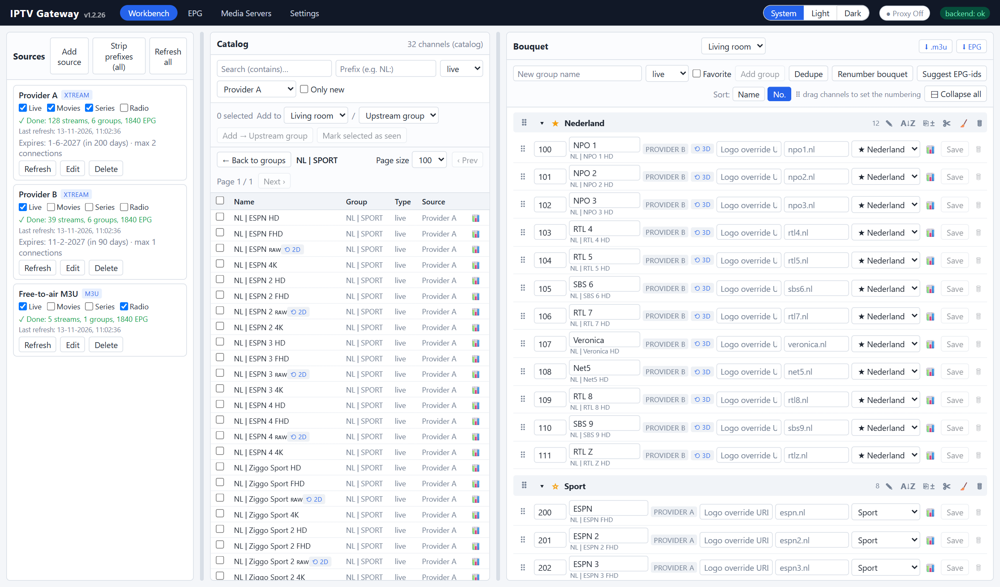

# Getting started

A step-by-step guide from a freshly installed gateway to a box that shows **your**
line-up. It takes about 15 minutes. For every screen in detail, see the
[User guide](USER-GUIDE.md).

> **Before you start:** IPTV Gateway does not provide any channels. You need at least
> one IPTV source you are entitled to use: an Xtream Codes login (server, username,
> password) or an M3U playlist URL. See the [disclaimer](../README.md#disclaimer).

In the examples below, `http://192.168.1.50:7777` is the address of your gateway.
Replace it with your own server's IP and port.

---

## Step 1: open the web app

1. Browse to `http://<your-server>:7777`.
2. Top right should read **backend: ok**.
3. **Set an admin password** (recommended, and required if the gateway can be
   reached from outside your home): set the `ADMIN_PASSWORD` variable in the Docker
   or Unraid template, or `adminPassword` in `config.json`, and restart the container.
   The web app then asks for it once.

## Step 2: add your source(s)

1. Go to **Workbench** and click **Add source** in the left panel.
2. Fill in:
   - **Name**: anything, e.g. `Provider A`.
   - **Kind**: `Xtream` (server + username + password) or `M3U` (a playlist URL).
   - **URL**, **Username**, **Password**: from your provider.
   - Content types: tick only what you want, e.g. just **Live** for TV channels.
     Fewer types means a faster refresh.
3. Click **Save**. The gateway now reads the channel list. Wait until the source
   shows **Done: … streams**.
4. *(Optional)* Add more sources the same way. Their channels end up in one
   catalog.

**Tips:**
- Some providers only accept certain apps. If a refresh fails with an HTTP error,
  edit the source and set **User-Agent** to `VLC/3.0.21 LibVLC/3.0.21`.
- **Strip prefixes**, e.g. `NL`, removes "NL |" from names when channels are added
  to your bouquet.
- **Include / exclude filters** hide whole countries or categories in the catalog.
  Nothing is deleted.

## Step 3: create a bouquet with its own login

A **bouquet** is the line-up a box will see. You can have several, for example
"Living room" and "Kids", each with its own login.

1. Go to **Settings → Output lists** and choose **➕ New list…**.
2. Enter a **Name**, a **Username** and a **Password**. Your box will log in with
   these.
3. Click **Add list**.

> If you leave the username empty, this bouquet becomes the default for boxes
> without a login. Only do that if the gateway is not reachable from the internet.

## Step 4: fill the bouquet

1. Go back to **Workbench**. Your bouquet is selected at the top of the right panel.
2. In the right panel, create your groups: type a name such as `Nederland`, `Sport`
   or `Movies` → **Add group**. Tick **Favorite** to pin a group to the top.
3. In the **Catalog** (middle panel), choose a source and click a group, or type a
   search term.
4. Tick the channels you want. At **Add to**, choose your bouquet and a group, then
   click **Add … → <group>**.
5. Repeat until your line-up is complete.

Tidy up in the right panel:
- **Rename** a channel by typing in its name field and clicking **Save**.
- **Order** channels and groups with drag and drop (also works on a tablet), or use
  A→Z.
- **Renumber bouquet** gives each group its own hundred (100, 200, …), so channel
  numbers are the same on every box.
- **📊** on a channel measures its quality variants (HD, UHD, 4K, …). **Use this**
  swaps to the best one.

## Step 5: TV guide (EPG)

1. Go to **EPG** and click **⟳ Update EPG**. The gateway fetches the guide for the
   channels in your bouquets.
2. Check that your channels show programmes.
3. **Better guide (recommended):** go to **Settings → Extra EPG sources**, paste one
   XMLTV address per line (for example a country guide, `.xml` or `.xml.gz`), click
   **Save settings**, then click **⟳ Update EPG** again. Channels are matched
   automatically by name.
4. A channel still without a guide: in the bouquet, use **Suggest EPG-ids**, or type
   a tvg-id in the channel's tvg-id field.

The guide is refreshed automatically every night. You can set the time under
**Settings → Daily refresh**.

## Step 6: connect your box

### Option A: as an Xtream Codes portal (recommended)

This works with TiviMate, IPTV Smarters, OTT Navigator, Formuler/MyTVOnline,
MAG apps and others. In the app, add a playlist or portal of type
**Xtream Codes (API)**:

| Field | Value |
|---|---|
| Server / URL | `http://192.168.1.50:7777` |
| Username | the bouquet username from step 3 |
| Password | the bouquet password from step 3 |

The app gets the channels, groups, numbers, logos and guide automatically, and on
supporting apps also catch-up (⟲).

### Option B: as an M3U playlist

For apps without Xtream support:

| | URL |
|---|---|
| Playlist | `http://192.168.1.50:7777/get.php?username=<user>&password=<pass>&type=m3u_plus&output=ts` |
| Guide (EPG) | `http://192.168.1.50:7777/xmltv.php?username=<user>&password=<pass>` |

**Every box that logs in with the same bouquet gets exactly the same line-up.**
When you change the bouquet, boxes pick it up on their next refresh. Some apps need
a manual "refresh playlist" or "update EPG".

## Step 7 (optional): Plex Live TV & DVR

1. Go to **Media Servers** and choose the **Bouquet for Plex / Jellyfin**.
2. Tick **Enable HDHomeRun tuner**, and enter the gateway address at **Base URL**
   (e.g. `http://192.168.1.50:7777`).
3. In Plex go to **Settings → Live TV & DVR → Set up Plex DVR**. Plex finds the
   tuner automatically, or you add it by its address `http://192.168.1.50:7777`.
4. For the guide, choose **"Have an XMLTV guide on your server"** and use
   `http://192.168.1.50:7777/plex/epg.xml`.
5. If channels don't play in Plex, enable **stream via proxy** for the tuner in
   **Media Servers**.

**Notes:**
- Auto-discovery needs **host networking** for the container (SSDP, UDP 1900).
  With bridge networking, add the tuner by its URL.
- Plex has no catch-up of the provider's archive. Use its DVR to record instead.

## Step 8: keep it up to date

- **Unraid:** with the template's repository `ghcr.io/iptvgateway/iptvgateway:latest`,
  a new version shows up as **update ready** on the Docker tab. One click updates it.
  Your settings and data in `/data` are kept.
- **Docker:** `docker pull ghcr.io/iptvgateway/iptvgateway:latest`, then recreate
  the container.

---

## Troubleshooting

| Problem | What to check |
|---|---|
| The box says "login failed" | Server URL incl. port, and the bouquet username and password (case-sensitive). Is the bouquet enabled in **Settings → Output lists**? |
| A channel doesn't play | Does it play directly from your provider? Some providers allow only one connection at a time. Try another quality variant (📊). |
| No guide for a channel | **EPG → ⟳ Update EPG**; add an **extra EPG source**; set a tvg-id. On the box: "update EPG" (some apps cache the guide for a day). |
| A source fails to refresh | Set the source's **User-Agent** to `VLC/3.0.21 LibVLC/3.0.21`; check the account's expiry date shown on the source. |
| Something else | Open the **Log** tab, type a word in the filter (e.g. `failed`, `timeshift`, a channel name), and click **Download** to share the log. |
