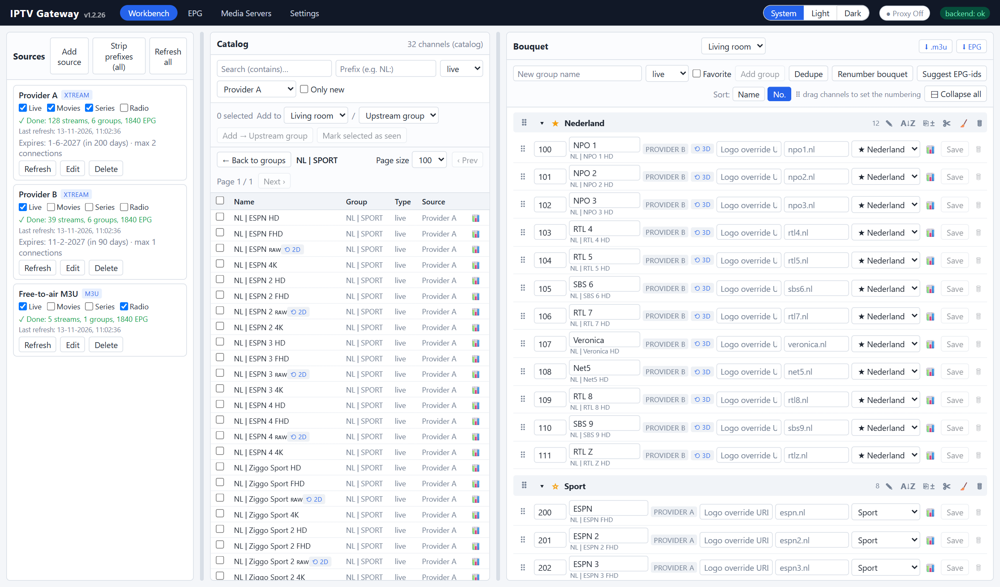
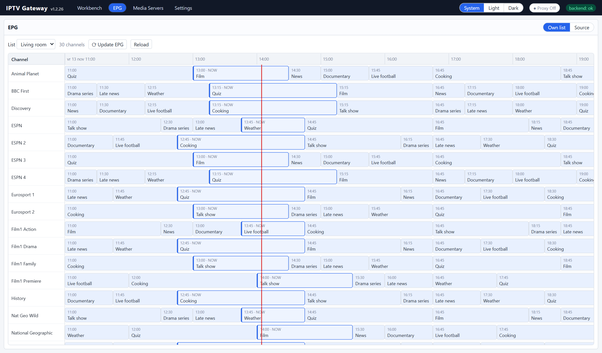
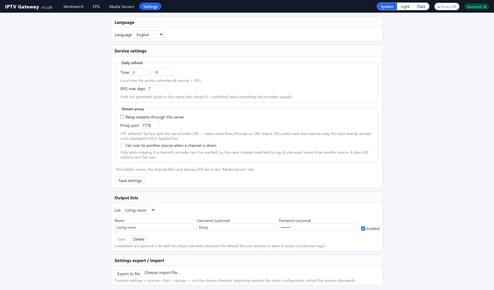

# IPTV Gateway — User Guide

IPTV Gateway aggregates the IPTV providers you already have access to into **one
curated line-up**, and republishes that line-up as its own **Xtream Codes portal
+ M3U + XMLTV guide**. Point any IPTV box (or Plex) at *this* service and it sees
a clean, merged, renamed, sorted channel list.

> **Streaming never flows through this service by default.** The box always
> reaches your provider directly: the M3U/Xtream output hands out the *raw
> upstream URL* (or a 302 redirect to it). Only if you enable the optional
> **stream proxy** does video pass through the gateway.

---

## Features at a glance

- **Multiple sources** — Xtream Codes portals and M3U / M3U_plus playlists, all
  merged into one catalog.
- **Per-source control** — enable/disable each content type (Live / Movies /
  Series / Radio); per-provider **User-Agent** and **Referer** overrides.
- **Name filters** — include (whitelist) / exclude (blacklist) by prefix or
  suffix, with auto-discovered prefixes; non-destructive.
- **Prefix stripping** — drop leading tokens (e.g. `NL`) from channel names when
  they enter your line-up.
- **Curated bouquet** — your own groups (with **★ always-on-top** pins),
  **drag to reorder groups and channels** (or A→Z), and per-channel overrides:
  **name, logo, channel number, group, and tvg-id** (searchable picker).
- **Change tracking** — new channels/categories are flagged; mark them seen.
- **De-dupe & tidy** — remove duplicate channels (same stream), empty a group,
  collapse groups, sort by name or number.
- **EPG** — fetches each provider's XMLTV and re-serves your own guide for just
  the channels on your list; optional **max-days** cap.
- **Outputs** — Xtream portal (`player_api.php`), M3U (`get.php`), XMLTV
  (`xmltv.php`), and 302 stream redirects; **multiple output lists**.
- **Optional stream proxy** — relay video through the gateway (for use abroad or
  when the box can only reach the gateway).
- **Plex Live TV** — M3U+XMLTV tuner *and* HDHomeRun emulation (+ SSDP
  auto-discovery), each toggleable with its own proxy choice; one-click **Rescan
  Plex**.
- **Built-in web admin UI**, daily auto-refresh, **settings export/import**
  (clone a whole setup), optional **HTTPS** and **admin password**.
- **Multi-language UI** — English and Dutch built in; add your own language by
  dropping a translation file in the mounted `lang/` folder, then pick it in
  Settings.

> 📷 _Screenshots live in `docs/screenshots/`. To (re)generate them from a running
> instance, run `node tools/capture-screenshots.mjs` (see that file's header for
> the one-time Playwright setup)._

---

## The big picture

```
Providers ──read──▶ Catalog (all channels, merged, change-tracked)
                       │  you pick & curate
                       ▼
                    Bouquet (your list: groups, names, numbers, tvg-ids)
                       │  published as
                       ▼
   Xtream portal · get.php (M3U) · xmltv.php (EPG) · Plex tuner
                       ▼
                  IPTV box / Plex
```

The app is a single page with three tabs in the header: **Workbench**, **EPG**,
**Settings**.


---

## Header (always visible)

- **Theme** — System / Light / Dark.
- **● Proxy On/Off** — global stream-proxy toggle (see *Stream proxy*).
- **↻ Refresh Plex** — appears only when the bouquet changed since the last Plex
  rescan *and* a Plex tuner is enabled; click to tell Plex to reload its
  guide/line-up. Disappears once rescanned.
- **backend: ok** — health indicator.
- **Logout** — shown when an admin password is set.

---

## 1. Workbench

Three panels (on a phone/tablet a single-panel switcher: **Sources / Catalog /
Bouquet**).



### Sources
Your upstream providers. Click **Add source** (or **Edit** on a source) to open
the editor dialog and add an **Xtream portal** or an **M3U / M3U_plus playlist**.
The list itself stays compact — each row shows the name, type, content-type
toggles, ingest status, and Refresh/Edit/Delete.

In the editor dialog, per source you can set:
- **Content types** (Live / Movies / Series / Radio) — toggle each on/off; a
  disabled type is never ingested or offered.
- **Name filters** — *Include* (keep only names matching a token, prefix or
  suffix) and *Exclude* (drop matching names). Tick discovered prefixes or type
  tokens. Filters never delete; drop a filter and the channels reappear.
- **Strip prefixes** — leading tokens (e.g. `NL`) removed from a channel name
  when it's added to your bouquet (so `NL| NPO 1` becomes `NPO 1`). `;`-separated;
  the original catalog name is kept.
- **User-Agent / Referer** — per-provider overrides (some portals require a
  specific UA or a Referer).
- **Refresh** — re-read this source now; a live status line shows progress
  (busy / done with counts / error), and each source shows its **last refresh**
  time. **Refresh all** runs every source in parallel.

Two buttons at the top of the Sources panel act on everything:
- **Refresh all** — re-read every source (parallel).
- **Strip prefixes (all)** — retro-actively apply each source's strip-prefixes to
  **all channels already on your lists** (handy if you set a prefix *after* adding
  channels). Manual renames are left untouched.

The backend reads each source, **merges** it into the catalog, flags genuinely
**new** items, and fetches the source's **XMLTV EPG** for the channels you chose.


### Catalog
The merged view of everything ingested from all sources.
- Filter by source, content type, **search** (multi-word = AND), or a leading
  **prefix**; show **only new** items.
- **Change tracking:** new channels/categories are badged `new`; **mark seen** to
  clear the badge.
- **Add to bouquet:** multi-select channels and add them to a list (and a group)
  in one go.


### Bouquet (your curated list)
The heart of the product — what the box/Plex actually receives.
- **Groups** are operator-created. A group can be flagged **★** — note this is
  *not* a separate "favorites" collection but an **“always on top”** pin: starred
  groups are kept above the rest. Default order: **starred groups first → then your
  manual group order → then A→Z** for any groups you haven't positioned yet.
- **Reorder groups by drag:** grab a group's **⠿** handle (in its header) and drag
  it up/down to set the group order; it's saved and reflected in all output.
  (Starred groups always stay pinned on top.)
- **Channel numbers / sorting:** sort a group by **Name** or by **No.**, or — in
  **No.** mode — **drag &amp; drop** channels to set an explicit order (the channel
  numbers are then generated from the order you dropped them in). There's also a
  one-click **Sort A→Z** that renumbers a group alphabetically.
- **Per channel** you can override: **display name**, **logo**, **channel
  number**, **group**, and the **tvg-id** (the guide id used for EPG/Plex — a
  searchable picker offers the tvg-ids known in your catalog; empty = use the
  upstream tvg-id). Empty overrides fall back to the upstream value.
- **🗑** removes a channel from the list. Groups can be **collapsed** (Expand
  all / Collapse all). There's a **dedupe** (drop duplicate channels by upstream
  URL) and an **empty group** action.
- A **list picker** at the top switches between output lists.


---

## 2. EPG

Two views: the **source** guide for a single channel and the **curated** guide
for the active list (only the channels on your bouquet). You can trigger an
**EPG re-fetch** for the listed channels without a full catalog refresh. How many
days the guide spans is whatever your provider supplies (cap it in Settings →
*EPG max days*).



---

## 3. Settings



### Language
The admin UI ships with **English** (default) and **Dutch** built in — pick one
from the **Language** dropdown at the top of Settings. To add another language,
drop a translation file in the mounted **`lang/`** folder (on Unraid: the
*Languages* path mapping, e.g. `/mnt/user/appdata/iptv-gateway/lang`) and it
appears in the dropdown automatically.

A language file is a JSON dictionary named `<code>.json` (e.g. `de.json`), keyed
by the **exact English UI string** → its translation, plus an optional `_name`
key for the label shown in the dropdown:

```json
{
  "_name": "Deutsch",
  "Workbench": "Arbeitsbereich",
  "Settings": "Einstellungen",
  "Save settings": "Einstellungen speichern"
}
```

Any string you leave out falls back to English, so a partial file is fine.

### Service settings
- **Daily refresh** — local time the service re-reads all sources + EPG.
- **EPG max days** — cap the served guide to N days ahead (0 = unlimited / take
  whatever providers give).
- **Stream proxy** — OFF (default): the box gets the raw provider URL, video
  never flows through the gateway. ON: output URLs point back here and the
  service relays the bytes (handy abroad, or when the box can only reach the
  gateway). Costs bandwidth/CPU. Runs on its own port (default 7778).

### Media Servers (Plex / Jellyfin)
Its own header tab. Two independent tuner surfaces, each on/off with its own proxy
choice:
- **M3U + XMLTV tuner** → add in Plex/Jellyfin as an M3U tuner
  (`/plex/playlist.m3u`) + XMLTV guide (`/plex/epg.xml`).
- **HDHomeRun emulation** → Plex auto-detects it (SSDP, UDP 1900) or you add it by
  URL; advertises a configurable tuner count.
- **Plex server + token** (optional) → enables the **Rescan Plex** button.
- **Base URL / channel filter / dummy EPG** → the base URL used to build the tuner
  URLs, a global group filter, and filler programmes for channels without real EPG.

**Channel name / ordering options** (config keys shown; all default `false`,
Plex/Jellyfin output only — your plain box `get.php`/`xmltv.php` keep clean names):
- **`nameShowGroup`** — prefix each channel name with its group, e.g. `Sport · NPO 1`
  (Plex's HDHomeRun tuner can't show groups otherwise).
- **`nameShowNumber`** — prefix a **zero-padded sort number** in bouquet order, e.g.
  `018 NPO 1` (or `18 NPO 1` when you have < 100 channels — the width follows your
  highest channel number). This number is the **same value as the HDHomeRun
  `GuideNumber`** and is added to the **XMLTV `<display-name>`** as well, because
  Plex's *Alphabetical* guide sorts by that display-name — so numbering it forces
  your exact bouquet order. It's **idempotent** (a name already starting with that
  number isn't prefixed twice) and never touches the channel/`tvg-id`, so the EPG
  coupling is unaffected. Combine both → `018 Sport · NPO 1`.
  *Tip:* Plex caches its channel mapping per DeviceID — after enabling this, use
  **New tuner ID** (Media Servers) and re-add the DVR in Plex so it re-imports.

### Output lists
What an IPTV box authenticates as. Pick a list from the dropdown to edit it, or
**New list…** to add one. Each list has an optional **username/password**; a list
with an **empty username becomes the default** the box resolves to when it sends
no/unknown login. (v1 typically uses a single list.)

### Settings export / import
**Export** the whole configuration (sources + lists + groups + the chosen
channels, each with its upstream stream) to one JSON file; **Import** replaces
everything — a 1:1 clone to another instance. The catalog is rebuilt for the
chosen channels, so the clone works without a refresh first.

---

## What the backend does / can

- **Ingest** Xtream and M3U/M3U_plus sources; per-source content-type gating and
  a tolerant parser.
- **Merge & change-track:** one catalog across all sources, `is_new` detection,
  mark-seen.
- **EPG:** fetches each provider's XMLTV, stores it per tvg-id, and **re-serves
  its own guide restricted to the channels on your list** (matched by tvg-id).
- **Curate:** lists, groups (with ★ always-on-top pins), per-channel rename / logo
  / number / tvg-id, prefix-stripping, dedupe, canonical ordering.
- **Publish (Xtream emulation):**
  - `player_api.php` — account + live/vod/series categories & streams,
  - `get.php` — the M3U (raw upstream URLs, or proxy URLs when the proxy is on),
  - `xmltv.php` — the curated XMLTV guide,
  - `live|movie|series/{user}/{pass}/{id}` — **302 redirect** to the upstream URL.
  Unknown credentials → 401; empty/none → the default list.
- **Stream proxy (optional):** a dedicated relay that fetches the upstream (with a
  VLC-style UA, following the provider's redirects) and streams `video/mp2t` to
  the box — so video flows box ↔ gateway ↔ provider.
- **Plex:** M3U+XMLTV tuner and HDHomeRun emulation (+ SSDP), per-surface proxy
  choice, and an API-driven rescan.
- **Scheduler:** refreshes channels + EPG daily at the configured time.
- **Multi-list** output; optional **HTTPS** for the portal; optional **admin
  password** protecting the `/api` admin surface (the box endpoints use their own
  output credentials).

---

## Ports & networking

| Port | Proto | When                                     |
|:----:|:-----:|------------------------------------------|
| 7777 | TCP   | always                                   |
| 7778 | TCP   | only when the stream proxy is enabled    |
| 1900 | UDP   | only with HDHomeRun emulation (LAN-only) |

**7777** — the one port that does almost everything: the admin web UI + `/api`,
the box-facing portal (`player_api.php`, `get.php`, `xmltv.php`, stream 302s), and
the Plex endpoints (`/plex/playlist.m3u`, `/plex/epg.xml`, HDHomeRun
`discover.json` / `lineup.json`). Configurable in **Settings**.

**7778** — the optional **stream-proxy** relay (`/live|movie|series/…`). Only
listens when the proxy is on. Configurable in **Settings**.

**1900** — **SSDP**, so Plex can auto-discover the HDHomeRun tuner on the LAN.
Fixed (the SSDP standard mandates 1900). **LAN-only — never forward it.**

So one port (**7777**) covers everything except the optional proxy; enable the
proxy → also open **7778**; want Plex to *auto-find* the tuner → also allow
**UDP 1900** on the LAN (otherwise just add the tuner by URL). **HTTPS needs no
extra port** — the same port serves TLS when `useHttps` is on.

> **Docker:** publish 7777 (and 7778 if you proxy). SSDP/UDP 1900 does **not**
> cross Docker bridge NAT — use **host networking** for auto-discovery, or add the
> tuner by URL. **Going public:** forward only the TCP port(s) you need, never UDP
> 1900; serve over **HTTPS** and set an **admin password** first.

---

## Connecting a box

Point your IPTV box at the gateway as an **Xtream Codes** portal:
- Server: `http://<gateway-host>:7777`
- Username / Password: the list's output credentials (or leave blank for the
  default list).

Or use the **M3U + EPG** URLs directly:
- M3U: `http://<gateway-host>:7777/get.php?username=<u>&password=<p>&type=m3u_plus&output=ts`
- XMLTV: `http://<gateway-host>:7777/xmltv.php?username=<u>&password=<p>`

---

## Plex (Live TV & DVR)

- **Option A — M3U tuner:** in Plex add an M3U tuner pointing at
  `http://<host>:7777/plex/playlist.m3u` and an XMLTV guide at
  `http://<host>:7777/plex/epg.xml`. (The Plex playlist auto-numbers channels
  uniquely — Plex rejects M3U tuners with duplicate channel numbers.)
- **Option B — HDHomeRun:** Plex auto-detects the emulated tuner via SSDP (UDP
  1900), or add it by URL (`http://<host>:7777`). For the guide, choose **“Have an
  XMLTV guide on your server”** and use `http://<host>:7777/plex/epg.xml` (the
  same guide URL). The exact URLs are also shown in **Settings → Plex Live TV**.
- **For playback via a Plex tuner, enable the proxy** for that surface (Settings →
  Plex Live TV → “stream via proxy”): a 302 to the raw provider often won't play in
  Plex's tuner, but the relay feeds it clean MPEG-TS. The relay starts automatically
  when any proxy option is on.
- **Per-channel EPG** needs a tvg-id; set one on the bouquet channel if the
  provider didn't supply it.
- **Refreshing:** Plex caches the line-up. It refreshes the *guide* on its own
  schedule, but **adding/removing channels needs a re-scan in Plex** (or use the
  **Rescan Plex** button if you set the Plex server + token).
- **Docker caveat:** SSDP (UDP 1900) does **not** cross Docker bridge NAT. For
  auto-discovery run the container with **host networking**, or add the tuner by
  URL. Set `publicBaseUrl` to the real host so Plex can fetch the lineup.

---

## Notes & limits

- Streaming is direct (box ↔ provider) unless the proxy is on.
- The served EPG only spans what your providers deliver (cap with *EPG max days*).
- Some providers gate on User-Agent and use multiple 302 redirects — set a
  per-source UA if a source won't ingest, and a player UA (e.g. `VLC/...`) on the
  box for playback.
- A provider's first alphabetical channels are often `### … ###` placeholders
  that don't stream — test with a real channel.
- The Docker image is **amd64 only** (matches Unraid).
