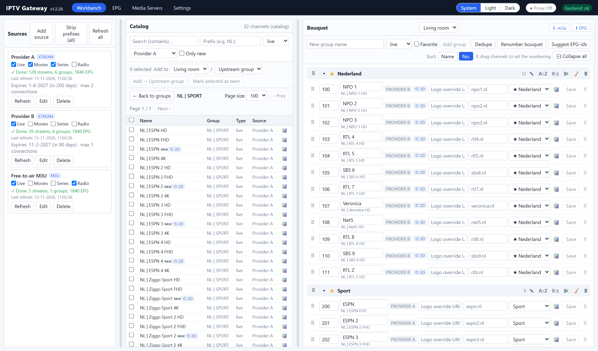
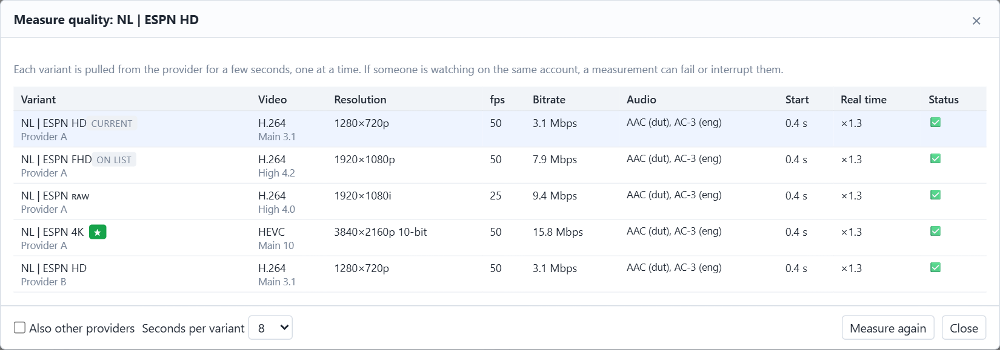
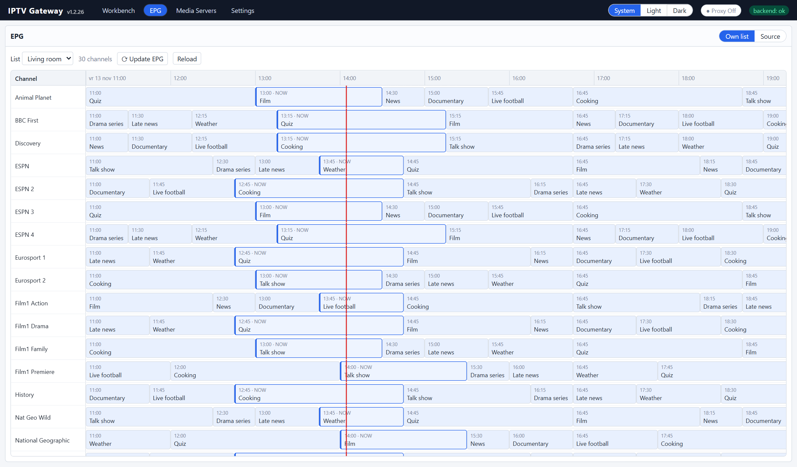

---
hide:
  - navigation
---

# IPTV Gateway

**Merge the IPTV subscriptions you already have into one clean, curated line-up,
and serve it as your own Xtream Codes portal, M3U playlist, XMLTV guide and
HDHomeRun tuner.**

Point any IPTV box (TiviMate, IPTV Smarters, OTT Navigator, MAG/Formuler apps…) or
Plex at the gateway and it sees *your* bouquet: merged across providers, renamed,
regrouped, numbered and sorted, with only the guide data for the channels you
actually chose.

[Get started](GETTING-STARTED.md){ .md-button .md-button--primary }
[User guide](USER-GUIDE.md){ .md-button }
[GitHub](https://github.com/IPTVGateway/IPTVGateway){ .md-button }



<small>Screenshots use fictional demo data. No real provider is shown.</small>

!!! note "Video does not flow through the gateway by default"
    Boxes get the provider's own URL (M3U) or a `302` redirect to it (Xtream). Only the
    optional stream proxy relays video. It is meant for use abroad, or for boxes that
    can only reach your home server.

## Why

- **Curate in a browser, not with a remote.** Search, multi-select, drag and drop,
  rename and number your channels on a computer, tablet or phone. The box only needs
  a server address, a username and a password, entered once.
- **Hide what you never watch.** Providers deliver tens of thousands of channels. You
  pick what goes in the bouquet, so the box shows a short, tidy list.
- **Set up once, use on every box.** Every box that logs in with the same bouquet
  credentials gets exactly the same layout: same order, numbers, names and guide.
- **One change, everywhere.** Rename a channel, move it, or swap it to a better quality
  or another provider, and every box picks it up on its next refresh.
- **A better TV guide.** Add an extra XMLTV guide and the gateway matches it to your
  channels by name or tvg-id, so every channel gets one consistent guide.
- **Different people, different line-ups.** Several bouquets on the same sources, each
  with its own login.
- **Light.** One native binary (Delphi), a Docker image of about 38 MB, SQLite built in.
  No interpreter, no worker containers, no database server.

## Features

**Sources** · Xtream Codes portals and M3U / M3U_plus playlists, merged into one
catalog · Live / Movies / Series / Radio per source on or off · daily automatic
refresh of channels and EPG · new channels and groups are flagged.

**Curating** · your own groups, ★ favourite groups on top, drag-and-drop ordering
(also on a tablet) · name filters and prefix/suffix stripping · per channel: name,
logo, number, group and tvg-id · bouquet-wide renumbering · swap a group to another
quality or provider · 📊 quality probe (codec, resolution, bitrate) without ffmpeg.

**TV guide** · only the guide data of the channels you chose · extra XMLTV sources
with automatic matching · dummy EPG for channels without a guide.

**Output** · Xtream emulation (`player_api.php`, `get.php`, `xmltv.php`), series and
VOD info · catch-up / timeshift · Plex Live TV & DVR via HDHomeRun emulation or
M3U + XMLTV · optional stream proxy and cross-provider failover · optional HTTPS and
admin password · update notice in the web app.

| Quality probe | Guide (EPG) |
|---|---|
|  |  |
| Measure every quality variant of a channel and swap to the best one in one click. | The guide for exactly the channels in your bouquet. |

## Install

**Unraid:** search for **IPTV Gateway** in the Apps tab (Community Applications).
New versions show up as **update ready**.

**Docker:**

```bash
docker pull ghcr.io/iptvgateway/iptvgateway:latest   # or: mvanrijnen/iptvgateway:latest (Docker Hub)
curl -LO https://github.com/IPTVGateway/IPTVGateway/releases/latest/download/docker-compose.yml
docker compose up -d
# web app: http://<host>:7777/
```

Use host networking if you want Plex to discover the HDHomeRun tuner over SSDP.
**Windows:** the gateway also runs as a native Windows Service; see the
[repository](https://github.com/IPTVGateway/IPTVGateway#build-from-source).

Then follow the **[step-by-step guide](GETTING-STARTED.md)**: add a source, build a
bouquet with its own login, set up the guide and connect your box.

## Help

- **Questions:** the [support thread on the Unraid forum](https://forums.unraid.net/topic/201311-support-iptvgateway/).
- **Bugs and ideas:** [GitHub issues](https://github.com/IPTVGateway/IPTVGateway/issues/new/choose).
  Never post provider URLs, usernames or passwords.
- **What changed:** the [changelog](changelog.md) and the
  [releases](https://github.com/IPTVGateway/IPTVGateway/releases).

## Disclaimer

**IPTV Gateway is a playlist and EPG management tool. It contains no content,
channels, streams, playlists, provider addresses or credentials, and it never
will.**

- The project does not provide, sell, host, index or link to any TV channels, films,
  series or other media. It does not endorse or recommend any IPTV service, and no
  provider is affiliated with this project.
- It only reorganises sources that **you** configure yourself: playlists and portals
  you are entitled to use.
- Many "IPTV subscriptions" sold online redistribute copyrighted broadcasts without
  permission. In many countries, including the EU (CJEU C‑527/15 *Filmspeler*), using
  such services can itself be unlawful. **Make sure you have the right to access every
  stream you add.**
- The software is provided "as is", without warranty of any kind
  ([MIT licence](https://github.com/IPTVGateway/IPTVGateway/blob/main/LICENSE)).

Rights holders with a concern can open an issue and it will be looked into promptly.
